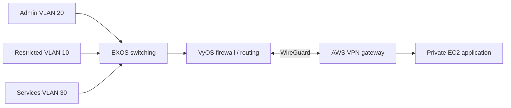

# Hybrid Cloud Network: Segmentation and Site-to-Cloud Routing

A lab network design built around ExtremeXOS switching, a VyOS router/firewall, and a WireGuard connection to AWS. It documents the routing and security decisions behind connecting separate local networks to a cloud application without giving every client unrestricted reachability.

## Network layout



The admin segment can reach selected services and cloud resources. The restricted segment cannot initiate connections to the admin or cloud segments. Firewall rules, switch tagging, AWS security groups and both directions of routing must agree; a WireGuard handshake alone does not prove the application is reachable.

## What's here

- `docs/architecture.md`: routing and segmentation decisions
- `docs/security-controls.md`: proposed trust boundaries
- `docs/verification-matrix.md`: positive and negative connectivity tests
- `config/segmentation-policy.yaml`: human-readable policy reference, **not** a VyOS config generator
- `terraform/`: parameterized AWS EC2 and security-group scaffold

The Terraform scaffold is deliberately incomplete. It does **not** establish a working VPN, create VPC route tables, configure WireGuard keys, or bootstrap the EC2 instances. Those require separate implementation and testing.

## Review the cloud portion

```bash
cd terraform
cp terraform.tfvars.example terraform.tfvars
# Supply IDs and allowed source networks for a disposable AWS lab.
terraform init
terraform fmt -check
terraform validate
terraform plan
```

Running `terraform apply` would create billable cloud resources. Nothing in this public repository has been applied or integration-tested.

## What would prove it works

The verification matrix includes tests for intended traffic **and** blocked traffic. A successful ping proves less than people think: test application reachability, return routes, firewall denies, and whether the private instance is accidentally accessible from the internet.

This public design excludes the original appliance images, historical screenshots, live cloud metadata, WireGuard keys, and password hashes. Do not treat it as a ready-to-deploy VPN appliance.
