# Hybrid Cloud Network | Tested EXOS, VyOS, WireGuard & AWS Capstone

**ExtremeXOS switching · 802.1Q VLANs · VyOS routing/firewall · DHCP · WireGuard · AWS EC2 · Terraform**

I built and tested a segmented network in September 2026 using **two ExtremeXOS switches in GNS3, a VyOS router, separate client/service VLANs, and a WireGuard site-to-cloud tunnel connected to real AWS EC2 instances**. The capstone included eight verification groups covering address assignment, switching, routing, firewall behavior, cloud network state and VPN reachability.

**The original capstone was implemented and tested.** The `terraform/` directory is a *separate, generalized portfolio example* of part of the AWS infrastructure, not an export of the original live deployment or a one-command reproduction of the VPN.

## The network at a glance

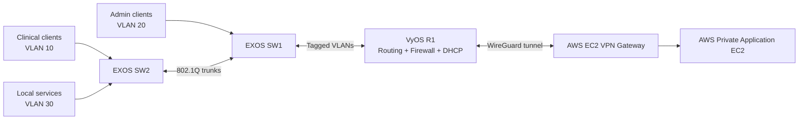

| Test path | Expected | Observed in original lab |
| --- | --- | --- |
| EXOS tagged uplinks and VyOS subinterfaces | VLANs 10, 20 and 30 connected | **Verified** with switch and router CLI |
| Admin and Clinical DHCP | Distinct leases and gateways | **Verified** in both VPCS clients |
| Local Services host | Static IPv4 with working default route | **Verified** on Linux host |
| Admin → Services and Clinical | Allowed | **Passed** |
| Clinical → Services and Admin | Denied | **Timed out**, consistent with deny policy |
| VyOS → AWS WireGuard peer | Handshake plus traffic | **Verified**, including packet counters |
| Admin → AWS private application | Allowed through tunnel | **Passed** |
| Clinical → AWS private application | Denied | **Timed out**, consistent with firewall policy |
| AWS return routing | Routes to site VLAN networks | **Verified** in EC2 route-table output |

The screenshot evidence below comes from the original capstone test environment, not a newly deployed AWS account.

## 1. Switching and inter-VLAN routing

Two EXOS switches configured with VLAN 10 (Clinical), VLAN 20 (Admin) and VLAN 30 (Services), with tagged 802.1Q uplinks. VyOS provided the corresponding VLAN interfaces and policy routing.

**EXOS switch configuration**

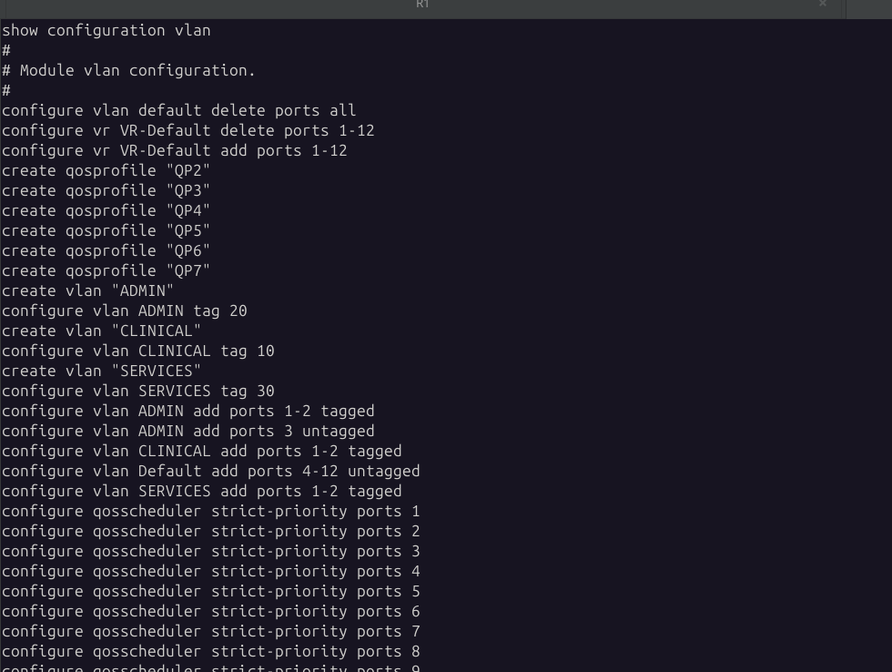

**VyOS VLAN subinterfaces**

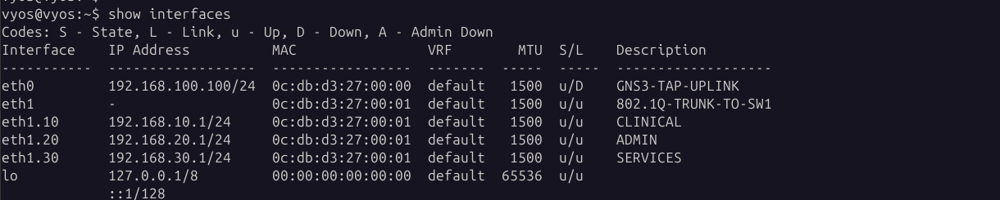

[SW1 screenshot](docs/evidence/exos-sw1-vlans.png) · [SW2 screenshot](docs/evidence/exos-sw2-vlans.png) · [SW1 saved VLAN excerpt](docs/configs/sw1-exos-vlans.txt) · [SW2 saved VLAN excerpt](docs/configs/sw2-exos-vlans.txt)

## 2. Firewall policy: test both allowed and blocked traffic

VyOS enforced a default-deny forwarding policy with specific allowances from Admin. Both positive and negative tests were recorded. A timeout alone is not proof of firewall causality, so the CLI policy evidence is included alongside reachability results.

| Admin → local Services: permitted | Clinical → local Services: denied |
| --- | --- |
| 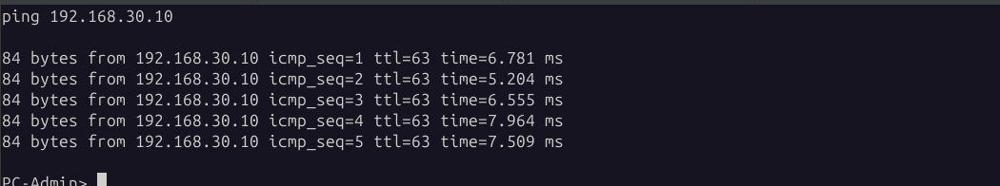 | 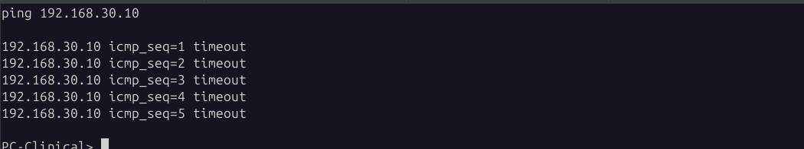 |

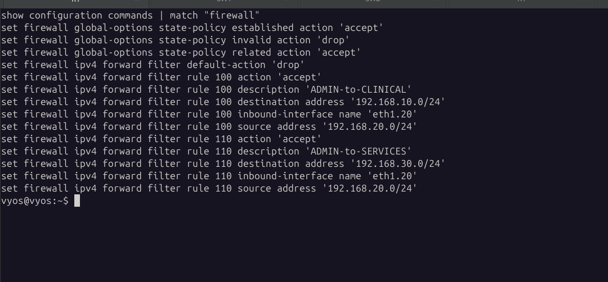

[Admin → Clinical allowed](docs/evidence/admin-clinical-allowed.png) · [Clinical → Admin blocked](docs/evidence/clinical-admin-blocked.png)

## 3. Working WireGuard tunnel to AWS

The site router established a WireGuard handshake with the AWS gateway, and traffic counters advanced. More importantly, the completed lab also tested **actual Admin-to-AWS reachability** and blocked Clinical-origin traffic. The tunnel interface alone would not establish routing correctness.

**Handshake and transfer counters (original evidence, endpoint and keys redacted)**

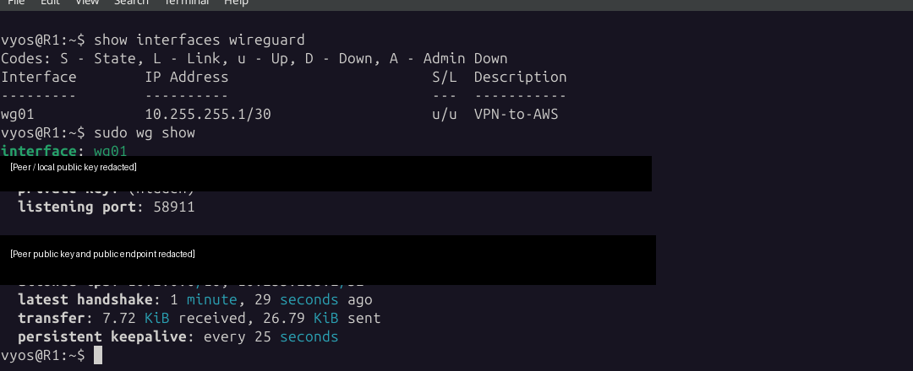

| Admin → AWS application: permitted | Clinical → AWS application: blocked |
| --- | --- |
| 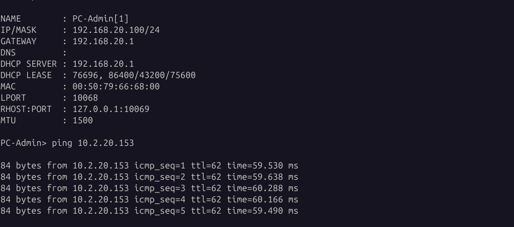 | 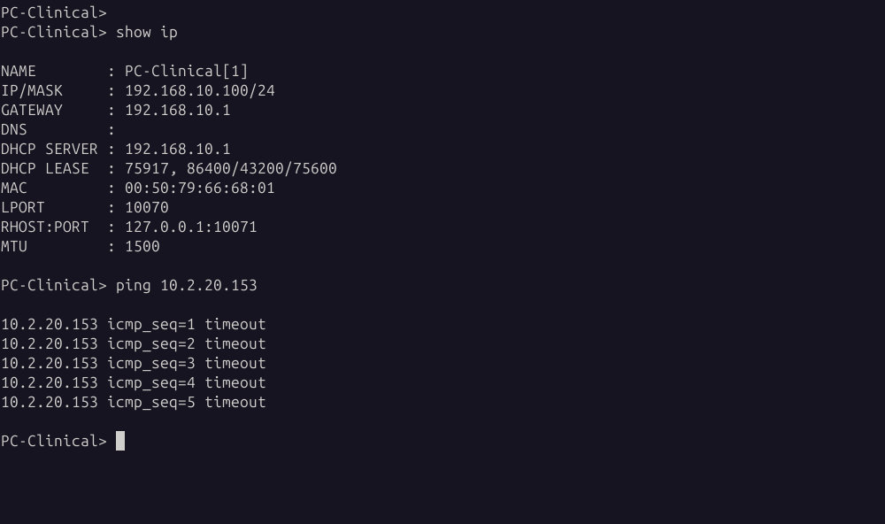 |

**AWS return routes (historic cloud resource IDs masked)**

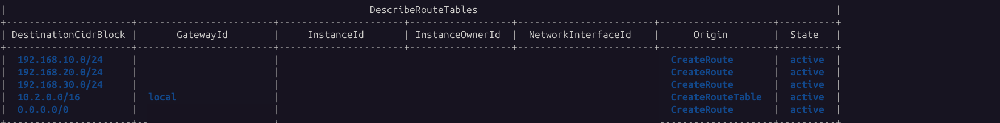

## 4. Addressing, cloud segmentation and supporting evidence

The original test environment assigned Admin and Clinical clients separate DHCP leases, gave the local Services host static addressing and a default route, and placed VPN/application instances on separate AWS subnets.

<details>
<summary><strong>Expand: DHCP, static routing and AWS instance evidence</strong></summary>

**Admin DHCP lease**

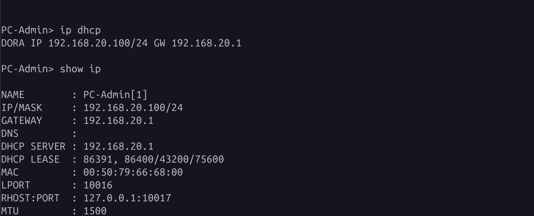

**Clinical DHCP lease**

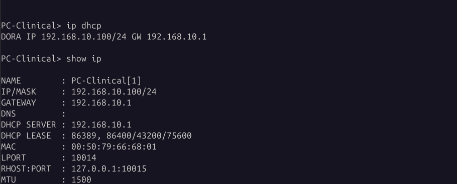

**Local Services static address and default route**

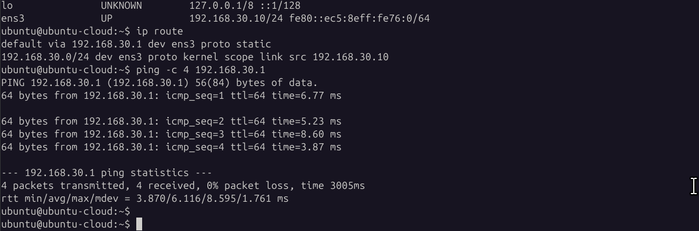

**AWS EC2 instance state (historic public IP and subnet IDs redacted)**

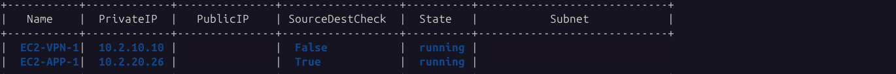

</details>

## Verification report and configuration

The original implementation was assessed through **eight capstone test groups**, not merely eight screenshots. The published evidence is a curated subset of the complete historical submission. For the original test scope and limitations see [the capstone verification report](docs/capstone-verification.md).

- [Network architecture and implementation boundary](docs/architecture.md)
- [Capstone test results](docs/capstone-verification.md)
- [EXOS SW1 config excerpt](docs/configs/sw1-exos-vlans.txt) and [SW2 config excerpt](docs/configs/sw2-exos-vlans.txt)
- [Security and publication boundaries](docs/security-controls.md)
- [Future generalized-deployment verification matrix](docs/verification-matrix.md)

### Sanitization and evidence integrity

The evidence images are **cropped from historical screenshots**, not synthetic terminal output. Where necessary, historical cloud resource IDs and the public VPN endpoint are obscured; lab-local RFC1918 addresses remain to demonstrate subnetting and reachability. Cropping removes irrelevant desktop content and unrelated student-interface information. Redactions do not modify the reported command results. Original materials remain outside this public repository.

## Separate Terraform example (not the original deployment)

The checked-in `terraform/` folder provisions illustrative EC2 instances and security groups within an **existing** AWS VPC and subnets. It does **not** install WireGuard, configure EXOS or VyOS, create the needed network routes, configure the private application, or recreate the full capstone.

```bash
cd terraform
cp terraform.tfvars.example terraform.tfvars
# Use a disposable AWS account and supply your own authorized IDs and CIDRs.
terraform init
terraform validate
terraform plan
```

Review the plan and AWS costs before applying anything. GitHub Actions validates the Terraform example's static configuration; it does **not** run a live VPN, network isolation or deployment test. The original capstone resources are not asserted to be running today.

## Engineering notes

During the capstone I investigated a missing VyOS default route, a mismatched WireGuard peer public key, and DHCP initialization issues. I used AI assistance while sanitizing and writing the public documentation and reusable infrastructure example. The screenshots, switch configuration excerpts and original lab test findings are clearly distinguished from the subsequently revised code.