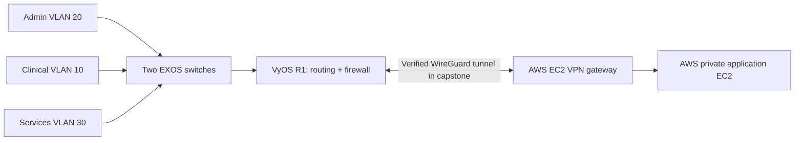

# Hybrid Cloud Network: Implemented Capstone and Reusable AWS Example

**ExtremeXOS · VyOS · VLANs/802.1Q · WireGuard · AWS EC2 · Routing · Firewall Policy · Terraform**

This repository documents two **separate stages of work**:

1. **Completed capstone (September 2026):** I built and verified a hybrid network connecting a GNS3 lab to real AWS EC2 resources. The local lab used two ExtremeXOS switches, a VyOS router, separate department/service VLANs, and a WireGuard tunnel to AWS. Eight test cases documented local and cloud addressing, routing, permitted access, and blocked access. Selected cropped, privacy-reviewed screenshots and configuration excerpts from that implementation are included below.
2. **Standalone public Terraform example:** The `terraform/` and `config/segmentation-policy.yaml` files are a smaller, generalized demonstration of the design. They are **not the exact deployed capstone configuration** and are **not a working one-click VPN**. They have passed static Terraform validation, not a new end-to-end apply.

The original capstone was tested in a temporary learning environment. This repository does **not** imply that its AWS instances, VPN peer, or GNS3 topology are still operating today.

## What I actually built and verified

The completed capstone used these isolated lab segments:

| Segment | VLAN | Function |
| --- | ---: | --- |
| Clinical | 10 | Restricted client network |
| Admin | 20 | Authorized management clients |
| Services | 30 | Locally hosted services |

SW1/SW2 used tagged 802.1Q uplinks. VyOS R1 provided inter-VLAN routing, DHCP, firewall policy, and WireGuard termination. AWS had separate VPN/application EC2 instances and routing between its subnets. Admin-to-AWS traffic traversed the tunnel; restricted Clinical-to-AWS traffic was blocked by the router policy.

**Evidence:**

- EXOS switch configuration: [SW1](docs/evidence/exos-sw1-vlans.png) · [SW2](docs/evidence/exos-sw2-vlans.png) · [SW1 configuration excerpt](docs/configs/sw1-exos-vlans.txt) · [SW2 configuration excerpt](docs/configs/sw2-exos-vlans.txt)
- VLAN routing and security: [Admin → Clinical allowed](docs/evidence/admin-clinical-allowed.png) · [Clinical → Admin blocked](docs/evidence/clinical-admin-blocked.png) · [VyOS default-drop firewall](docs/evidence/vyos-firewall.png)
- Working site-to-cloud VPN: [WireGuard handshake and traffic counters](docs/evidence/wireguard-handshake.png) · [Admin → AWS allowed](docs/evidence/admin-aws-allowed.png) · [Clinical → AWS blocked](docs/evidence/clinical-aws-blocked.png)

Representative original evidence, cropped to show relevant results:


For the full test scope, observations, and limitations, see [Capstone implementation and verification](docs/capstone-verification.md).

## Architecture



The completed test demonstrated selective network reachability, not unrestricted connectivity. Successful admin pings and blocked Clinical pings were both recorded. A successful handshake alone would not have been sufficient: the tests also checked AWS return routes and VyOS firewall rules.

## Public Terraform design example

The `terraform/` folder creates illustrative AWS EC2 and security-group resources for an existing VPC with public/private subnets. Its allowed management and VPN source CIDRs are narrow by design. **It does not configure WireGuard peers, VyOS, switch ports, OS bootstrap, route-table updates, or the application.**

```bash
cd terraform
cp terraform.tfvars.example terraform.tfvars
# Fill in safe test-account details; review charges before applying.
terraform init
terraform validate
terraform plan
```

GitHub Actions checks Terraform validation. The historic screenshots above are evidence of the **original capstone**, not of this revised Terraform example. No live access keys, WireGuard private keys, real public VPN endpoint, account identifiers, or uncropped desktops are included in the evidence selection.

## Development notes

I designed and configured the original lab environment and investigated issues including a missing VyOS default route, a mismatched WireGuard peer public key, and early DHCP startup. I used AI assistance while preparing this public documentation and generalized examples. The original capstone's eight tests and historic evidence are separated from subsequent example code so an interviewer can see what was actually built.
