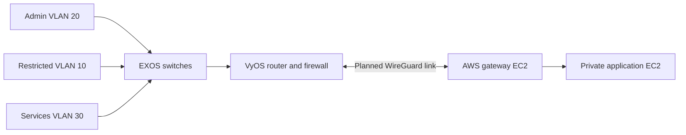

# Hybrid Cloud Network

I wanted a small network where an admin VLAN could reach an application in AWS without opening that application up to every machine on the LAN. The idea is to separate the local VLANs, route through VyOS, and use WireGuard between the site and AWS.

This is a lab network design based on coursework in routing, segmentation, and cloud infrastructure. The repo contains a design and some AWS provisioning code, not a working site-to-cloud VPN. I used AI assistance when reworking the public example.

## Network layout



Admin machines should reach only the services they're supposed to. Restricted clients shouldn't be able to initiate connections to admin hosts or the cloud application. The application EC2 instance has no public IP.

Getting a WireGuard handshake is only step one. The VPC and VyOS need the right routes and firewall rules in both directions, or the application still won't work.

## What's included

- `docs/architecture.md`: routing decisions and work still needed
- `docs/security-controls.md`: intended access rules
- `docs/verification-matrix.md`: traffic that should **pass and fail**
- `config/segmentation-policy.yaml`: a readable policy sketch, not router configuration
- `terraform/`: AWS gateway/application instances and security groups

The Terraform expects an existing VPC with separate public and private subnets. Public management and WireGuard source IPs are restricted to specific `/32` addresses.

## Review the AWS side

```bash
cd terraform
cp terraform.tfvars.example terraform.tfvars
# Supply values for a disposable AWS account.
terraform init
terraform validate
terraform plan
```

Check the plan and AWS charges before applying anything. This code doesn't configure WireGuard, create all the needed routes, set up VyOS, or install the application.

## What would finish it

I still need to build the tunnel and routing, add the firewall rules, and run the tests in the verification matrix. I'm especially interested in showing that blocked traffic **stays blocked**, not just that the allowed traffic works.

This public version hasn't been deployed end to end. It contains no live VPN keys, virtual machine images, or  submission files.
